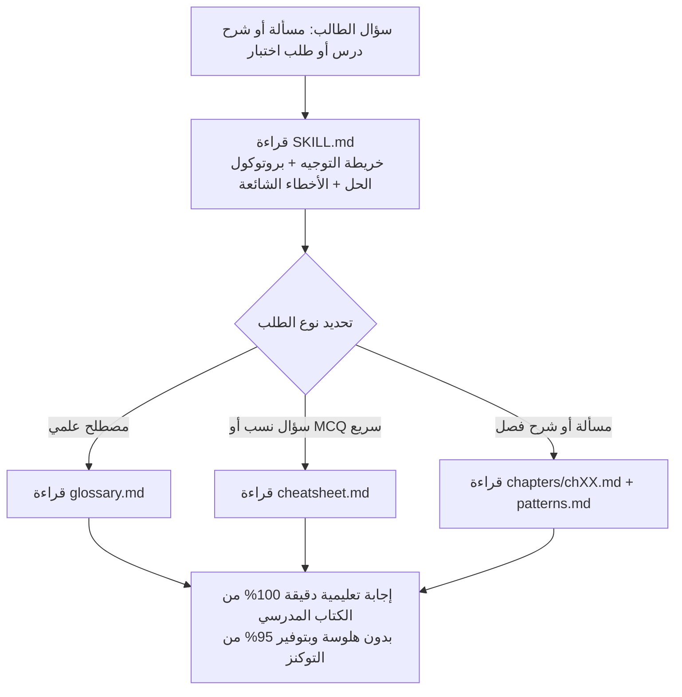

<div dir="rtl" align="right">

# 📚 Books-4-2-bakloriya — مهارات الذكاء الاصطناعي لمناهج البكالوريا المصرية

<p align="center">
  
  
  
</p>

مستودع منظم ومفتوح لتحويل الكتب المدرسية الرسمية لنظام **البكالوريا المصرية (الثانوية العامة)** إلى **مهارات ذكاء اصطناعي مهيكلة (Agent Skills)** باستخدام معيار [`book-to-skill`](https://github.com/virgiliojr94/book-to-skill).

بدلًا من رفع كتاب PDF حجمه مئات الميجابايت في كل محادثة واستهلاك آلاف التوكنز أو الحصول على إجابات غير دقيقة من خارج المنهج، يقوم هذا المشروع بتقسيم كل كتاب مدرسي إلى:
- **فهرس توجيه ذكي (`SKILL.md`)** يحدد القوانين، بروتوكول الحل، والأخطاء الشائعة.
- **ملفات فصول مستقلة (`chapters/ch00..chXX.md`)** يُحمّل الذكاء الاصطناعي منها الفصل المطلوب فقط عند السؤال عنه.
- **قاموس مصطلحات حرفي (`glossary.md`)**، **أنماط حل المسائل (`patterns.md`)**، و**ملخص قرارات ونسب سريعة (`cheatsheet.md`)**.

---

## 🎯 رؤية المشروع وتنظيم الصفوف الدراسية

صُمم المستودع ليكون قابلًا للتوسع ليضم كافة صفوف البكالوريا المصرية، مع **التركيز الكامل حاليًا على الصف الثاني بكالوريا (٢ ثانوي)**:

| الصف الدراسي | بادئة المهارات في `skills/` | المواد المتاحة حاليًا | الحالة |
|---|---|---|---|
| **٢ بكالوريا (الصف الثاني الثانوي)** | `second-year-*` | **الفيزياء** (`second-year-physics`) — 14 فصلًا كاملًا | 🟢 **متاح ومكتمل (التركيز الحالي)** |
| **٢ بكالوريا (الصف الثاني الثانوي)** | `second-year-*` | الكيمياء، الرياضيات، الأحياء، إلخ | 🟡 قيد الإضافة تباعًا |
| **١ بكالوريا (الصف الأول الثانوي)** | `first-year-*` | جميع المواد | ⚪ المرحلة القادمة |
| **٣ بكالوريا (الصف الثالث الثانوي)** | `third-year-*` | جميع المواد | ⚪ المرحلة القادمة |

### 📂 هيكلة المستودع

```text
Books-4-2-bakloriya/
├── README.md                              # دليل المشروع وطريقة ربط أي AI كمعلم ذكي
├── AGENTS.md                              # تعليمات تلقائية لوكلاء الذكاء الاصطناعي للعمل كمعلم
├── CLAUDE.md                              # نقطة دخول تلقائية لـ Claude Code
└── skills/                                # مجلد المهارات القياسي (متوافق مع npx skills add)
    └── second-year-physics/               # فيزياء ٢ بكالوريا (الصف الثاني الثانوي)
        ├── SKILL.md                       # الفهرس الرئيسي + بروتوكول المعلم والحل + خريطة التوجيه
        ├── glossary.md                    # قاموس المصطلحات العلمية الحرفية مرتب أبجديًا
        ├── patterns.md                    # 12 قالبًا قياسيًا لحل مسائل المنهج خطوة بخطوة
        ├── cheatsheet.md                  # قواعد القرار السريعة وجداول النسب والمقارنات
        └── chapters/                      # الفصول التفصيلية (تُقرأ عند الطلب On-Demand)
            ├── ch00-intro-quantities-units-vectors.md
            ├── ch01-velocity-vectors-relative-velocity.md
            ├── ch02-acceleration-equations-of-motion.md
            ├── ch03-horizontal-projectiles.md
            ├── ch04-angled-projectiles.md
            ├── ch05-torque.md
            ├── ch06-force-equilibrium.md
            ├── ch07-work-power-efficiency.md
            ├── ch08-momentum-impulse.md
            ├── ch09-conservation-momentum.md
            ├── ch10-momentum-mechanical-energy.md
            ├── ch11-circular-motion-centripetal.md
            ├── ch12-vertical-horizontal-circular.md
            └── ch13-kepler-gravitation.md
```

---

## 🔬 محتوى مهارة فيزياء ٢ بكالوريا (`second-year-physics`)

مستخرجة بالكامل من الكتاب المدرسي الرسمي (269 صفحة) وتغطي:

| الكود | الفصل | أبرز الموضوعات والقوانين |
|---|---|---|
| `ch00` | الكميات والوحدات والمتجهات | الكميات القياسية والمتجهة، الأساسية والمشتقة، بادئات SI، المسافة والإزاحة، تحليل المتجهات |
| `ch01` | متجهات السرعة والسرعة النسبية | محصلة سرعتين، السرعة النسبية $\vec{v}_{AB}=\vec{v}_A-\vec{v}_B$، مسائل عبور النهر، القطار والمطر |
| `ch02` | العجلة ومعادلات الحركة | العجلة المنتظمة، معادلات الحركة الأربع، السقوط الحر، ميل ومساحة منحنيات $(d\text{–}t, v\text{–}t, a\text{–}t)$ |
| `ch03` | المقذوفات الأفقية | استقلالية المحورين الأفقي والرأسي، $t=\sqrt{2h/g}$، المدى الأفقي، الحل بمعادلات الطاقة |
| `ch04` | المقذوفات بزاوية | زمن الصعود والتحليق، أقصى ارتفاع، المدى الأفقي، الزوايا المتتامة، المقذوف من مبنى لمنصة |
| `ch05` | عزم القوة والاتزان الدوراني | $M = Fd = FL\sin\theta$، قاعدة الإشارات، شرط الاتزان الدوراني $\sum M = 0$ والروافع |
| `ch06` | اتزان القوى وقانون نيوتن الأول | $\sum F_x=0, \sum F_y=0$، المخطط الحر، الشد في حبلين متماثلين ومختلفين، قوة النابض $F_e=-kx$ |
| `ch07` | الشغل والقدرة والكفاءة | $W = Fd\cos\theta$، $P = W/t = Fv\cos\theta$، الكفاءة $\eta$، مخطط سانكي، القدرة المهدرة |
| `ch08` | كمية التحرك والدفع | $P = mv$، $J = \bar{F}\Delta t = \Delta P$، الارتداد عن حائط، تطبيقات زمن التصادم والوسائد الهوائية |
| `ch09` | حفظ كمية التحرك | النظام المعزول، التصادم مع التحام، التصادم المرن، الانفجار والارتداد، التصادم ثنائي الأبعاد |
| `ch10` | الطاقة الحركية ومعامل الارتداد | $E_k = \frac{1}{2}mv^2$، الطاقة المفقودة $\Delta E_k$، معامل الارتداد $e = -\frac{v_B'-v_A'}{v_B-v_A}$ |
| `ch11` | الحركة الدائرية المنتظمة والقوة المركزية | $T, f, \omega, l=r\theta, v=\omega r$، علاقة هويغنس $a_C=v^2/r=r\omega^2$، القوة المركزية $F_C$ |
| `ch12` | الدائرية الرأسية والأفقية والبندول المخروطي | شد القمة/القاع/الجانب، السرعة الحرجة $v_{\min}=\sqrt{gr}$، البندول المخروطي، المخروط الدوار، حلقة الملاهي |
| `ch13` | قوانين كبلر والجاذبية الكونية | قوانين كبلر الثلاثة، الجذب العام لنيوتن، السرعة المدارية، شدة المجال $g$، المدار الجغرافي الثابت |

---

## 🤖 كيف يتصل أي ذكاء اصطناعي (AI) بهذا المستودع ويعمل كـ «معلم ذكي»؟

يمكنك ربط هذا المستودع بأي أداة ذكاء اصطناعي بـ **4 طرق مختلفة** حسب الأداة التي تستخدمها:

---

### الطريقة الأولى: عبر أمر واحد (`npx skills add`) — الأسرع لوكلاء الذكاء الاصطناعي
إذا كنت تستخدم **Claude Code** أو **GitHub Copilot CLI** أو **Cursor** أو **Windsurf** أو **OpenCode** أو **OpenAI Codex** أو **Amp**، شغّل هذا الأمر في الطرفية (Terminal):

```bash
npx skills add https://github.com/revolover00/Books-4-2-bakloriya --skill second-year-physics
```

بعد التثبيت، اكتب في محادثة الـ AI مباشرة:
- `/second-year-physics اشرح لي درس البندول المخروطي مع مثال محلول`
- `/second-year-physics حل هذه المسألة خطوة بخطوة: قُذفت كرة من أعلى مبنى...`

---

### الطريقة الثانية: فتح المستودع مباشرة كمشروع (Clone & Open)
بفضل وجود ملفَي **`AGENTS.md`** و **`CLAUDE.md`** في جذر المستودع، فإن أي أداة ذكاء اصطناعي تفتح هذا المجلد تتحول **تلقائيًا** إلى معلم خصوصي لمنهج البكالوريا المصرية دون أي إعداد إضافي:

```bash
git clone https://github.com/revolover00/Books-4-2-bakloriya.git
cd Books-4-2-bakloriya
```

ثم افتح المجلد بأي أداة (`claude`، `cursor .`، `opencode`، `codex`، أو **Arena.ai**) واسأل سؤالك مباشرة باللغة العربية!

---

### الطريقة الثالثة: الربط مع ChatGPT أو Claude Web أو Google NotebookLM
إذا كنت تستخدم واجهات الويب (بدون سطر أوامر):

1. **في Claude Projects أو ChatGPT Projects / Custom GPTs:**
   - اربط مستودع GitHub (`revolover00/Books-4-2-bakloriya`) مباشرة من خيار **Add from GitHub**، أو ارفع ملفات مجلد `skills/second-year-physics/` في قسم **Project Knowledge**.
   - انسخ **تعليمات المعلم الذكي (System Prompt)** التالية وضعها في خانة **Custom Instructions / Project Instructions**:

```text
أنت معلم خبير بمناهج البكالوريا المصرية.
عندما يسألك الطالب أي سؤال:
1. اقرأ أولًا ملف SKILL.md لتحديد الفصل المناسب وخريطة القوانين.
2. افتح ملف الفصل المقابل (ch00..ch13) أو الملفات المساندة (glossary.md للمصطلحات الحرفية، patterns.md لخطوات الحل، cheatsheet.md للنسب السريعة).
3. التزم حرفيًا بمصطلحات ورموز وقوانين الكتاب المدرسي المصري (مثل: المحور المجاور للزاوية يأخذ cos، ولا تقرّب الأرقام إلا في الخطوة النهائية).
4. اشرح بأسلوب معلم صبور: الفكرة التأسيسية ← القانون ووحداته ← خطوات الحل المرقمة ← التنبيه على فخ الامتحان الشائع في هذا الجزئية.
```

2. **في Google NotebookLM:**
   - أنشئ دفترًا جديدًا وارفع فيه ملف `SKILL.md` مع ملفات `chapters/*.md` و`cheatsheet.md` و`glossary.md` و`patterns.md`، وسيعمل كمعلم تفاعلي ومولّد اختبارات صوتية ومكتوبة من نص الكتاب الحرفي.

---

### الطريقة الرابعة: التثبيت اليدوي في مسار المهارات المحلي
إذا أردت نسخ المهارة يدويًا لتعمل في جميع مشاريعك على جهازك:

```bash
mkdir -p ~/.agents/skills ~/.claude/skills
cp -r skills/second-year-physics ~/.agents/skills/second-year-physics
ln -sfn ~/.agents/skills/second-year-physics ~/.claude/skills/second-year-physics
```

---

## 🧠 كيف يفكر الـ AI عندما يعمل كمعلم من خلال هذا المستودع؟



1. **توجيه ذكي (Routing):** يقرأ الـ AI ملف `SKILL.md` فقط في البداية ليعرف خريطة المنهج.
2. **تحميل عند الطلب (On-Demand Loading):** يفتح فقط ملف الفصل المطلوب (مثلًا `ch12` للبندول المخروطي) بدلًا من قراءة الكتاب كله.
3. **منهجية المعلم:** يطبق الخطوات السبع للحل، يلتزم بالتعريفات الحرفية، وينبّه الطالب على الأخطاء القاتلة التي يقع فيها الطلاب في الامتحانات.

---

## 💡 أمثلة لأسئلة يمكنك تجربتها مع المعلم الذكي

- **شرح درس:** *"اشرح لي الفرق بين الحركة الدائرية الرأسية والبندول المخروطي من حيث ثبات السرعة وقوانين الشد."*
- **حل مسألة خطوة بخطوة:** *"قُذفت كرة من أعلى مبنى ارتفاعه 20m بسرعة 25m/s بزاوية 30° مع الأفقي لتسقط على منصة ارتفاعها 5m. احسب زمن التحليق وأقصى ارتفاع والمدى الأفقي."*
- **تصحيح خطأ طالب:** *"أنا حليت مسألة ارتداد كرة كتلتها 2kg بسرعة 15m/s عن حائط بنفس السرعة وطلعت التغير في كمية التحرك صفر، ليه إجابتي غلط؟"*
- **توليد اختبار تدريبي:** *"اعمل لي امتحان قصير من 5 أسئلة اختيار من متعدد ومسألتين على الفصل 13 (قوانين كبلر والجاذبية) وصحح لي إجاباتي."*

---

## 🛠️ كيف تضيف كتابًا أو منهجًا جديدًا للمستودع؟

المستودع مجهز للعمل مع أداة [`book-to-skill`](https://github.com/virgiliojr94/book-to-skill):

1. ضع ملف الكتاب (PDF / EPUB / DOCX / TXT) داخل مجلد `uploads/` (وهو مستثنى في `.gitignore` لعدم رفع ملفات ضخمة).
2. اطلب من الوكيل الذكي:
   - **لإضافة مادة جديدة لـ ٢ بكالوريا:** *"حوّل الكتاب الموجود في `uploads/` إلى مهارة جديدة في `skills/second-year-<subject>` باستخدام `book-to-skill`"*
   - **لتحديث مادة موجودة بـأبواب جديدة:** *"استخدم وضع Update / Fold-in في `book-to-skill` لدمج الفصول الجديدة في `skills/second-year-physics`"*
3. يتم التحقق من جودة وأمان كل مهارة تلقائيًا عبر:
   ```bash
   python3 book-to-skill/tools/validate_skill.py skills/<skill-name>/SKILL.md
   python3 book-to-skill/tools/scan_generated_skill.py skills/<skill-name>
   ```

</div>
